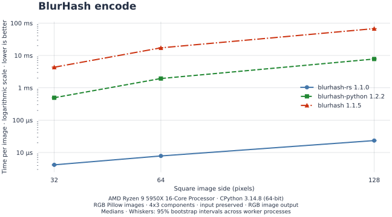
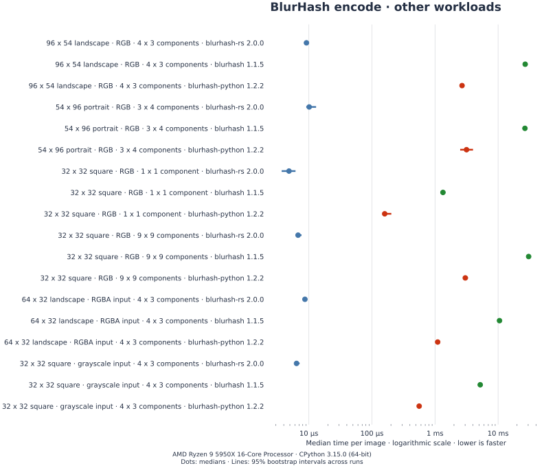
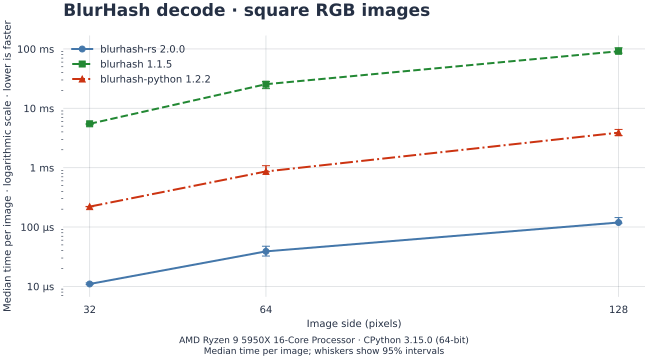
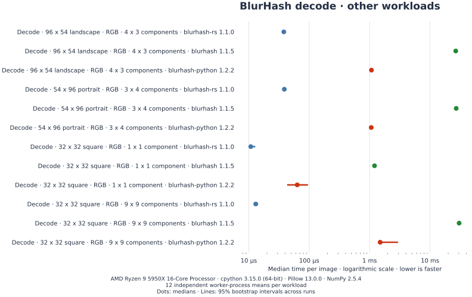

# blurhash-rs

Encode images as compact [BlurHash](https://blurha.sh) placeholders and decode
them into Pillow previews. Written in Rust, for Python 3.11+.

## Install

```sh
pip install blurhash-rs
```

## Encode and decode an image

```py
from PIL import Image
from blurhash_rs import blurhash_encode, blurhash_decode

image = Image.new("RGB", (24, 16), (40, 100, 180))
blurhash = blurhash_encode(image)
preview = blurhash_decode(blurhash, 32, 24)

print(blurhash)
```

`preview` is a 32 × 24 RGB image.

## Encode an image file

```py
from PIL import Image
from blurhash_rs import blurhash_encode

# Use your image's path.
with Image.open("photo.jpg") as opened:
    image = opened.copy()

image.thumbnail((100, 100))
blurhash = blurhash_encode(image, x_components=4, y_components=3)
```

You can also pass a filename directly to `blurhash_encode`. Images you supply
remain open and unchanged. Alpha is discarded, so composite transparent images
onto your chosen background first.

## Benchmarks

**About 130–380× faster encoding and 20–30× faster decoding** than
`blurhash-python` on square Pillow images.

<picture>
  <source media="(prefers-color-scheme: dark)" srcset="benchmarks/encode-dark.svg">
  
</picture>

<picture>
  <source media="(prefers-color-scheme: dark)" srcset="benchmarks/encode-workloads-dark.svg">
  
</picture>

<picture>
  <source media="(prefers-color-scheme: dark)" srcset="benchmarks/decode-dark.svg">
  
</picture>

<picture>
  <source media="(prefers-color-scheme: dark)" srcset="benchmarks/decode-workloads-dark.svg">
  
</picture>

| Workload, median time per image | blurhash-rs 1.1.0 | blurhash 1.1.5 | blurhash-python 1.2.2 |
| --- | ---: | ---: | ---: |
| Encode 32 × 32 square RGB, 4 × 3 | 4.12 µs | 5.07 ms | 524 µs |
| Encode 64 × 64 square RGB, 4 × 3 | 7.73 µs | 20.0 ms | 2.12 ms |
| Encode 128 × 128 square RGB, 4 × 3 | 22.1 µs | 78.6 ms | 8.37 ms |
| Decode 32 × 32 square RGB, 4 × 3 | 10.5 µs | 5.38 ms | 216 µs |
| Decode 64 × 64 square RGB, 4 × 3 | 31.8 µs | 21.6 ms | 841 µs |
| Decode 128 × 128 square RGB, 4 × 3 | 115 µs | 84.0 ms | 3.33 ms |

All three encoders produced identical hashes; decoded RGB channels differed by
at most one 8-bit level. Measurements used CPython 3.15.0, Pillow 13.0.0, NumPy 2.5.4,
and a Ryzen 9 5950X running Linux 7.2.9. Table values are medians of twelve
worker-process means; chart whiskers show 95% bootstrap intervals.

[Full workload medians](benchmarks/results.md) ·
Raw PyPerf results: [blurhash-rs](benchmarks/blurhash-rs.json),
[blurhash](benchmarks/blurhash.json), and
[blurhash-python](benchmarks/blurhash-python.json) ·
[Benchmark source](benchmark.py)

## API reference

### `blurhash_encode`

Pass a Pillow `Image` or a source accepted by `Image.open`. The x- and
y-component counts, each from 1 through 9, control the hash's detail.

### `blurhash_decode`

Pass a hash and positive output dimensions to get an RGB Pillow `Image`.
Use finite, nonnegative `punch` values to control contrast: zero shows the
constant DC color, values between zero and one reduce contrast, and values
above one increase it.

### `BlurhashDecodeError`

This exception reports an invalid hash, image dimension, or contrast scale
from `blurhash_decode`. Its `blurhash` attribute contains the hash passed to
the decoder.

[Full reference](python/blurhash_rs/__init__.py) ·
[Issues and questions](https://github.com/Zaczero/pkgs/issues) ·
[Private security reports](https://github.com/Zaczero/pkgs/security/advisories/new) ·
[Premium support](https://monicz.dev/#get-in-touch)
