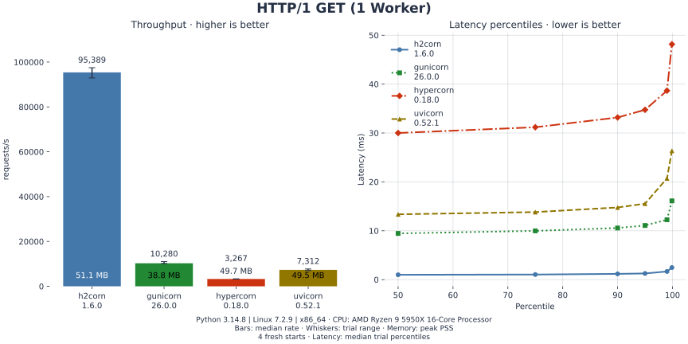

<p align="center">
  
</p>

<h1 align="center">h2corn</h1>

<p align="center">
  <strong>HTTP/2 ASGI for Python</strong>
</p>

<p align="center">
  Built in Rust, with HTTP/2 end to end.
</p>

<p align="center">
  <a href="https://pypi.org/p/h2corn"></a>
  <a href="https://liberapay.com/Zaczero/"></a>
  <a href="https://github.com/sponsors/Zaczero"></a>
</p>

<p align="center">
  <a href="https://h2corn.monicz.dev/">Documentation</a> ·
  <a href="https://h2corn.monicz.dev/quickstart/">Quickstart</a> ·
  <a href="https://h2corn.monicz.dev/configuration/">Configuration</a> ·
  <a href="https://h2corn.monicz.dev/benchmarks/">Benchmarks</a>
</p>

---

- **HTTP/2 end to end** — keep HTTP/2 on the proxy-to-app hop with `h2c`.
- **WebSockets** — HTTP/1.1 upgrades and HTTP/2 extended CONNECT (RFC 8441).
- **Direct TLS** — TLS 1.2 and 1.3, including mutual TLS with client-certificate details exposed to the application.
- **Operator controls** — worker management, reload, recycling, health checks, and bounded graceful shutdown.

## Install

h2corn supports CPython 3.11 and newer. See
[Python compatibility and wheels](docs/compatibility.md) for supported standard
and free-threaded builds.

```bash
pip install h2corn
```

<a id="a-60-second-start"></a>

## Quickstart

Run an existing ASGI application with `h2corn module:app`, or try this
[FastAPI](https://fastapi.tiangolo.com/) application (`pip install fastapi`):

```python
# hello.py
from fastapi import FastAPI

app = FastAPI()


@app.get('/')
async def index():
    return {'message': 'hello from h2corn'}
```

```bash
h2corn hello:app
```

Open <http://127.0.0.1:8000/>. Add `--reload` for development.

For production, use a TLS-terminating reverse proxy with a private `h2c`
upstream, or [terminate TLS in h2corn](https://h2corn.monicz.dev/deployment/tls/).
The [proxy recipes](https://h2corn.monicz.dev/deployment/proxy/) cover forwarded
headers and WebSocket routing. Keep HTTP/1.1 enabled for proxies that use
WebSocket upgrades; HTTP/2 WebSockets require RFC 8441 support along the route.

## Is h2corn right for you?

h2corn serves ASGI applications on Python 3.11+, including free-threaded
CPython. Linux and macOS support the multi-worker supervisor; Windows runs a
single worker. It is not a gRPC server.

Moving an existing deployment? See the
[migration guide](https://h2corn.monicz.dev/migrating/) for commands and changed defaults.

## Benchmarks

Compare h2corn, Uvicorn, Hypercorn, and Gunicorn serving the same Starlette
application with standard asyncio. HTTP/1.1 uses the controlled pure-Python
parser configurations for Uvicorn and Gunicorn; these results do not rank
their optional accelerated deployments.

<picture>
  <source media="(prefers-color-scheme: dark)" srcset="bench/results/plots/benchmark_http_1_get_1_worker-loopback-dark.svg">
  
</picture>

See [the measured environment, exact data, server configuration, and workloads](https://h2corn.monicz.dev/benchmarks/),
including HTTP/2, streaming, WebSockets, and 50 ms round-trip latency.

## Support

Bug reports, feature requests, and questions go in the
[GitHub issue tracker](https://github.com/Zaczero/pkgs/issues).

For deployment review, migration help, performance audits, or prioritized
work, commercial support is available through
[monicz.dev](https://monicz.dev). See the
[Support page](https://h2corn.monicz.dev/support/) for details.

Security disclosures use GitHub's
[private vulnerability reporting](https://github.com/Zaczero/pkgs/security/advisories/new).
