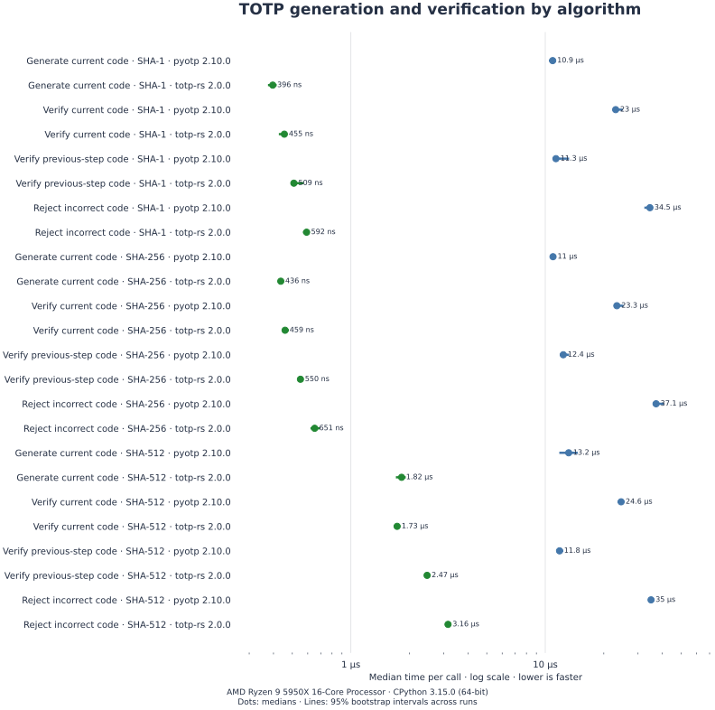

# totp-rs

Generate and verify time-based one-time passwords in Python, backed by Rust.
Supports [RFC 6238](https://datatracker.ietf.org/doc/html/rfc6238) with SHA-1,
SHA-256, or SHA-512. Python 3.11+.

## Installation

```sh
pip install totp-rs
```

## Usage

```py
from totp_rs import totp_generate, totp_verify

# Example secret; provision a unique random secret for each account.
secret = b'12345678901234567890'
code = totp_generate(secret)
print(code)  # Changes with the current time.
valid = totp_verify(secret, code, window=1)
```

Secrets may be raw bytes or Base32 text. `window=1` accepts the previous,
current, or next time step to allow for clock drift. Choose the algorithm,
number of digits, and step length to match the authenticator.

<a id="inputs-and-errors"></a>
<a id="mutually-exclusive-time-inputs"></a>

## Explicit timestamps

Pass `time` for a fixed Unix timestamp, or `time_window` for a counter directly;
the two are mutually exclusive. This example reproduces the RFC's SHA-1 test
vector:

```py
from totp_rs import totp_generate

code = totp_generate(b'12345678901234567890', digits=8, time=59)
print(code)  # 94287082
```

Timestamps must be finite and fit signed 64-bit whole seconds after flooring;
negative timestamps are supported. Deriving a counter requires a positive
step length. An explicit `time_window` uses the supplied counter directly and
ignores the step length and origin.

Verification compares code bytes in constant time, but validation and the drift
search can return early. The library does not store replay state or rate-limit
attempts; enforce those in your application.

## Benchmarks

The matched comparison measures code generation and verification with PyOTP
using SHA-1, SHA-256, and SHA-512. Lower time is faster.

<picture>
  <source media="(prefers-color-scheme: dark)" srcset="benchmarks/results-dark.svg">
  
</picture>

Both implementations use the same Base32 secret, timestamp, six-digit code,
30-second period, and ±1 verification window. The separate native-only results
measure generation from raw keys, generation from a precomputed time counter,
and time-counter extraction; they are not compared with PyOTP.

Across the four matched operations per algorithm, PyOTP median times were
23.7–59.3 times as long for SHA-1, 20.6–52 times as long for SHA-256, and
4.96–13.7 times as long for SHA-512 on this workstation.

The measured versions are totp-rs 1.0.0 and
[PyOTP 2.10.0](https://pypi.org/project/pyotp/2.10.0/). Runs used CPython
3.15.0 (Clang 23.1.3) with pyperf 2.10.0 on a shared Ryzen 9 5950X workstation
(Linux 7.2.9, microcode `0xa201213`). Each case has twelve independent
worker-process means from three calibrated readings of at least 0.1 seconds
each after one warmup. Six-worker batches ran totp-rs then PyOTP, followed by
PyOTP then totp-rs. The table reports medians and 95% percentile bootstrap
intervals from 10,000 resamples of worker-process means. Native wheels used
release builds with rustc 1.101.0-nightly (`4ebd25825`, LLVM 23.1.4) targeting
x86-64-v2. Warmup-only runs remain in the raw JSON but are excluded from the
reported values and intervals. Benchroom 0.1.0 and Matplotlib 3.11.2 generated
the report.

[Full results, including native-only input forms](benchmarks/results.md), raw results
([totp-rs](benchmarks/totp-rs.json), [PyOTP](benchmarks/pyotp.json)), and the
[benchmark](benchmark.py) and [report generator](tools/benchmark_report.py)
retain the measurement details.

## API reference and support

See the [`totp_time_window`, `totp_generate`, and `totp_verify` reference](https://github.com/Zaczero/pkgs/blob/main/totp-rs/python/totp_rs/_lib.pyi)
for parameters, defaults, and errors.

[Issues and questions](https://github.com/Zaczero/pkgs/issues) ·
[Private security reports](https://github.com/Zaczero/pkgs/security/advisories/new) ·
[Premium support](https://monicz.dev/#get-in-touch)
